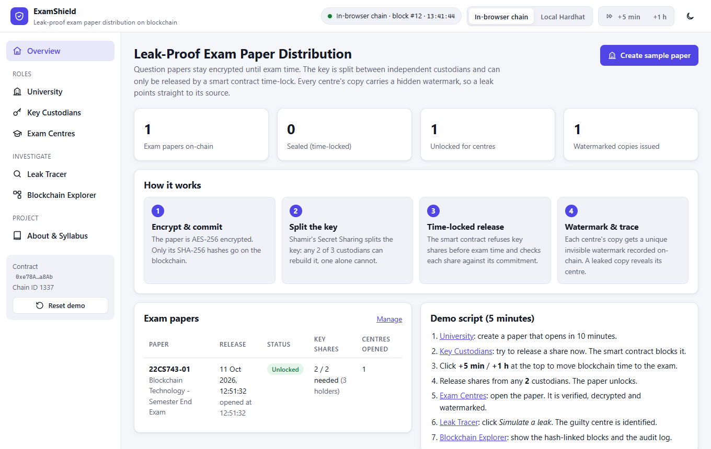
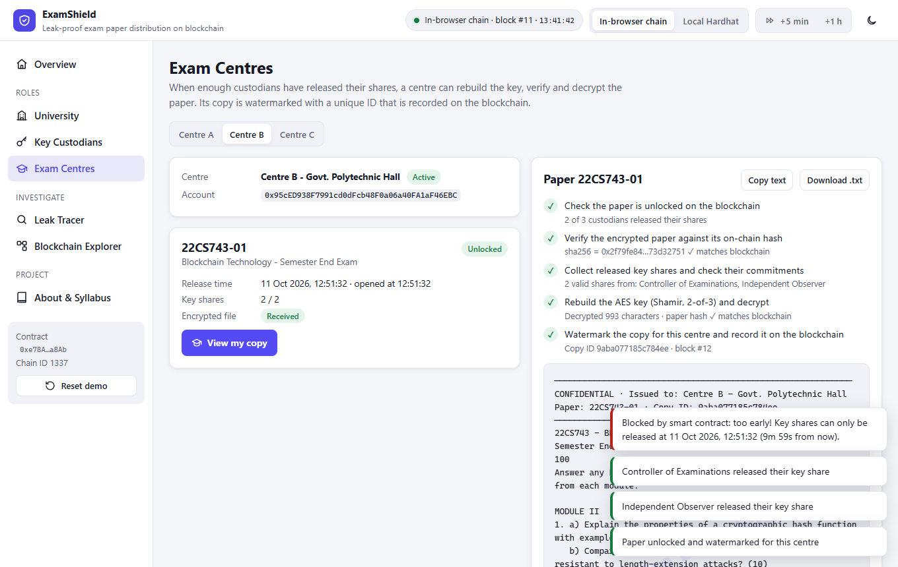
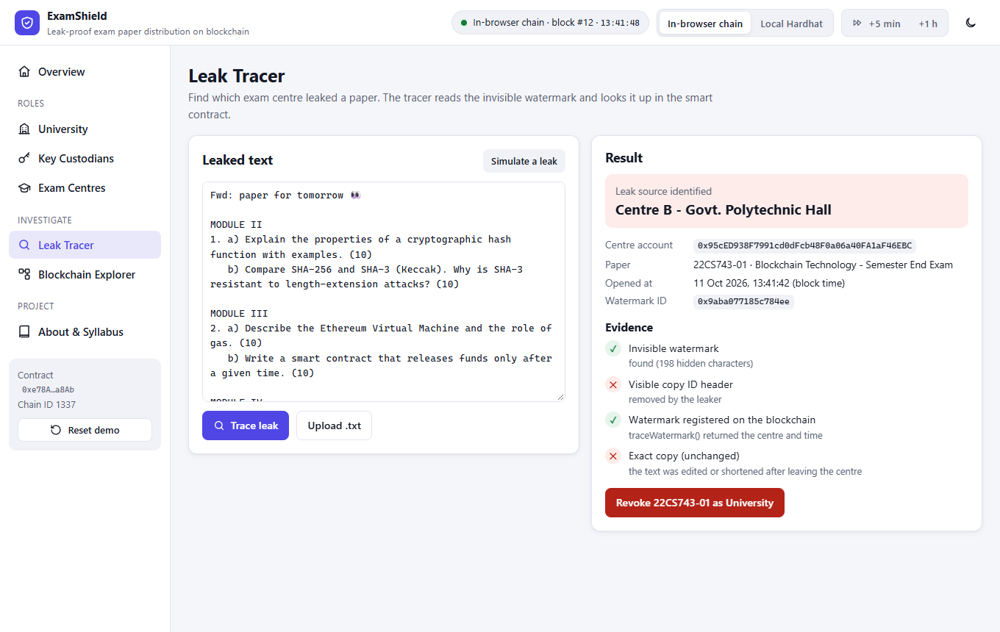
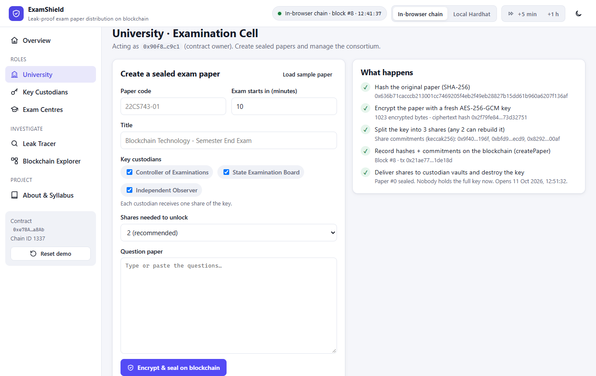
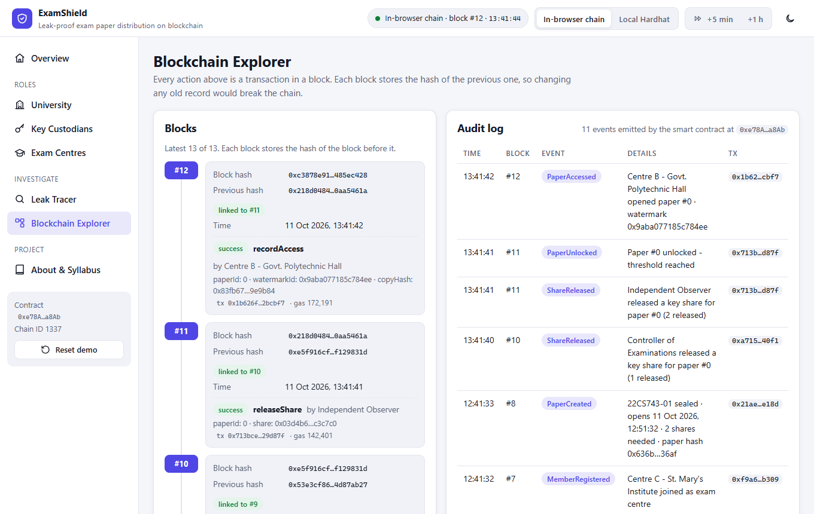
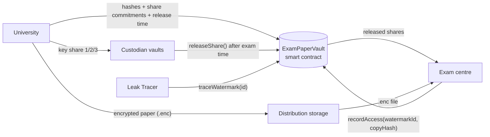

# ExamShield: Leak-Proof Exam Paper Distribution System

A blockchain system that keeps exam question papers **encrypted until exam time**, needs **2 of 3 independent custodians** to unlock them, and **traces a leaked copy back to the exam centre** that leaked it.

**Live demo:** https://syedareeb06.github.io/leak-proof-exam-paper/ (runs entirely in your browser: no wallet, no install, no real cryptocurrency)



---

## The problem

Question papers leak before exams. Today:

- one office or person holds the full paper, so a single insider can leak it,
- nothing *technically* stops early access, and
- when a copy appears on WhatsApp or Telegram, nobody can prove which centre it came from.

## The solution

| Step | What happens | Technique |
|---|---|---|
| 1. Encrypt & commit | The University encrypts the paper with a fresh AES-256 key. Only SHA-256 hashes go on the blockchain. | AES-256-GCM, SHA-256 |
| 2. Split the key | The key is split into 3 shares; **any 2** rebuild it, **1 alone reveals nothing**. Each share's keccak256 hash is committed on-chain. The full key is then destroyed. | Shamir's Secret Sharing |
| 3. Time-locked release | Custodians reveal their shares on-chain. The **smart contract rejects shares before the exam start time** and rejects any share that does not match its commitment. | Solidity smart contract |
| 4. Watermark & trace | Each centre's decrypted copy gets a unique invisible watermark whose ID is recorded on-chain. A leaked copy reveals the centre, even if the visible header is removed. | Zero-width watermark + on-chain registry |

## Features

- **University**: create sealed papers, manage the consortium (add / suspend members), revoke a leaked paper
- **Key Custodians**: hold key shares and release them (blocked by the contract before exam time)
- **Exam Centres**: verify, decrypt and open the paper with a 5-step integrity checklist
- **Leak Tracer**: paste leaked text → identifies the centre, opening time and evidence
- **Blockchain Explorer**: hash-linked blocks, decoded transactions and the full audit log
- **Time travel**: move blockchain time forward (+5 min / +1 h) to demo the time-lock in seconds
- Two blockchains: an **in-browser Ethereum chain** (zero setup) or a **local Hardhat node**

| Exam centre opens the paper | Leak tracer |
|---|---|
|  |  |

| University seals a paper | Blockchain explorer |
|---|---|
|  |  |

## Syllabus mapping (22CS743, Blockchain Technology)

| Module | Concepts | Where they appear in this project |
|---|---|---|
| **II** | Hash functions, SHA family, hash commitments, hash-linked blocks | SHA-256 of the paper and ciphertext, keccak256 commitments of key shares, explorer verifies each block's previous-hash link |
| **III** | Ethereum, EVM, smart contracts, symmetric & asymmetric cryptography | `ExamPaperVault.sol` enforces the time-lock and threshold; AES-256-GCM; every transaction is signed by an account key |
| **IV** | Consortium / permissioned blockchain | University, custodians and centres are registered members with roles; only the University can add or suspend members |
| **V** | Blockchain security, access control, privacy, applications | Role-based access, no secrets on-chain before release, audit trail, leak tracing and revocation |

## Architecture



**On-chain:** members and roles, paper hash, ciphertext hash, share commitments, release time, released shares (only after the exam starts), access records, watermark IDs.
**Off-chain:** the encrypted paper file and each custodian's private share. Blockchains are public, so nothing secret goes on-chain before the release time.

## Tech stack

- **Smart contract:** Solidity 0.8.24, Hardhat (local blockchain, tests, deployment)
- **Frontend:** HTML, CSS, JavaScript (no build step), ethers.js v6, Web Crypto API
- **Demo blockchain:** Ganache running inside the browser (same EVM, same contract)
- **Hosting:** GitHub Pages

## Project structure

```
leak-proof-exam-paper/
├── blockchain/                  # Smart contract project (Hardhat)
│   ├── contracts/ExamPaperVault.sol
│   ├── test/ExamPaperVault.test.js   # 17 unit tests
│   ├── scripts/deploy.js             # deploy + register demo consortium on localhost
│   ├── scripts/export-artifact.js    # copy ABI + bytecode into the web app
│   └── hardhat.config.js
├── frontend/                    # Web app (open index.html)
│   ├── index.html
│   ├── css/
│   ├── js/app.js                # ExamShield screens and logic
│   ├── js/exam-crypto.js        # AES-256-GCM, Shamir's Secret Sharing, watermark
│   ├── js/chain.js              # in-browser chain / local Hardhat connection
│   ├── js/contract-artifact.js  # compiled contract (generated)
│   └── vendor/                  # ethers.js, Ganache (browser builds)
├── docs/screenshots/
└── index.html                   # redirects GitHub Pages to frontend/
```

## How to run

### Option 1: Zero install (recommended for demos)

Open the [live demo](https://syedareeb06.github.io/leak-proof-exam-paper/), **or** double-click `frontend/index.html`.
An Ethereum blockchain starts inside the page. Your data is saved in the browser; click **Reset demo** in the sidebar to start over.

### Option 2: Local Hardhat blockchain

Requires [Node.js](https://nodejs.org/) 18 or newer.

```bash
cd blockchain
npm install
npm run node
```

Keep that terminal open. In a second terminal:

```bash
cd blockchain
npm run deploy
```

Then open `frontend/index.html` and click **Local Hardhat** in the top bar. (If you skip `npm run deploy`, the app deploys the contract itself.)

### Run the smart contract tests

```bash
cd blockchain
npm test
```

### After changing the contract

```bash
cd blockchain
npm run export
```

This recompiles and copies the new ABI and bytecode into `frontend/js/contract-artifact.js`.

## 5-minute demo script

1. **University** → *Create sample paper* → *Encrypt & seal on blockchain*. Watch the 5 steps (hash, encrypt, split key, transaction, hand-over).
2. **Key Custodians** → *Try to release now*. The smart contract blocks it: **"too early"**.
3. Click **+1 h** in the top bar to move blockchain time past the exam start.
4. Release shares from **2** custodians. The paper is now **Unlocked**.
5. **Exam Centres** → *Unlock & open paper*. Five integrity checks pass and a watermarked copy is shown.
6. **Leak Tracer** → *Simulate a leak*. The visible header is removed, yet the centre is still identified.
7. **Blockchain Explorer**: show the hash-linked blocks and the audit log.

## Publishing on GitHub Pages

1. Push this folder to a GitHub repository named `leak-proof-exam-paper`.
2. On GitHub: **Settings → Pages → Build and deployment → Source: Deploy from a branch → Branch: `main`, folder: `/ (root)` → Save**.
3. After about a minute the site is live at `https://syedareeb06.github.io/leak-proof-exam-paper/`.

## Limitations and future work

- After the exam starts, the released shares are public. That is acceptable because the exam has begun, and centres still need the encrypted file.
- Zero-width watermarks can be defeated by retyping the paper by hand. The visible copy ID and exact-hash check help there; printed papers would need image or print watermarks.
- In the demo, custodians' shares are kept in browser storage. Real custodians would use hardware tokens or wallets (for example MetaMask).
- A production deployment would run on a permissioned network such as Hyperledger Besu or Fabric operated by the consortium.

## License

MIT, see [LICENSE](LICENSE).
